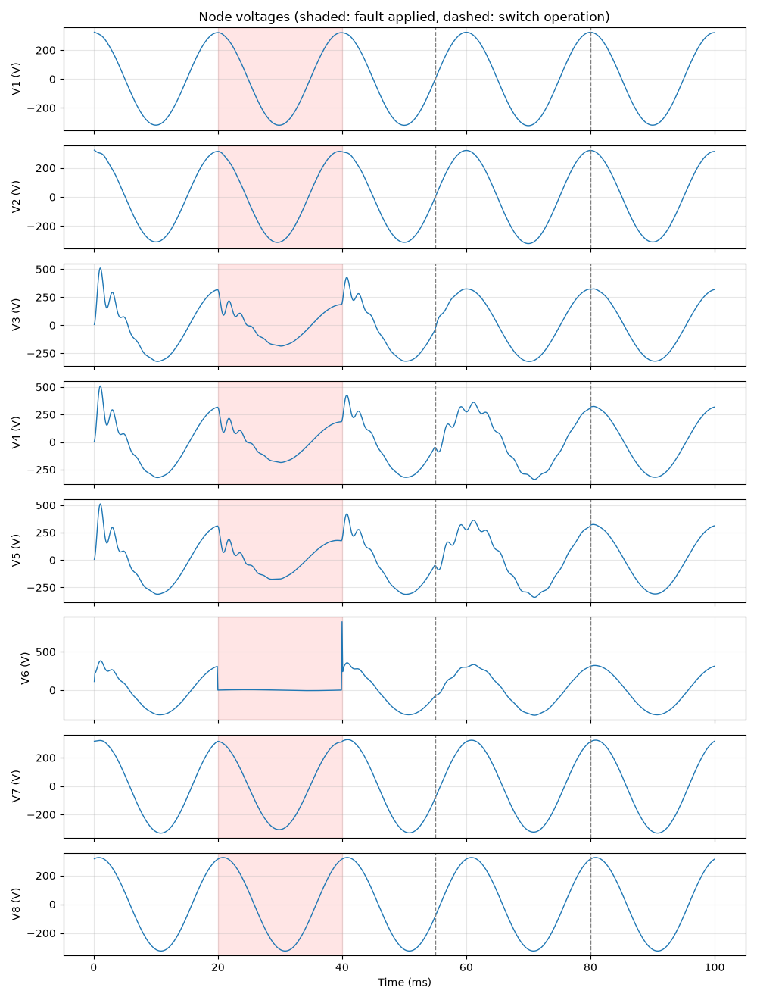

<p align="center">
  <picture>
    <source media="(prefers-color-scheme: dark)" srcset="docs/logo-dark.svg">
    
  </picture>
</p>

**EMTSim** is a small electromagnetic transients (EMT) simulator written in Python. It implements Dommel's nodal method: the same time-domain algorithm that runs underneath tools such as PSCAD/EMTDC and EMTP, kept small enough to read in one sitting.

It started as a learning project to understand what happens inside an EMT engine. Every step of the algorithm is a separate, commented method, so you can follow a simulation one time step at a time.

<p align="center">
  
</p>
<p align="center"><sub>Example network in <code>dataloader.py</code>: 8 nodes fed by two 230 V, 50 Hz sources (one Norton, one ideal, 15° apart). A bolted fault at bus 6 is applied at 20 ms and cleared at 40 ms. Breaker SW1 then opens at 55 ms, splitting the network in two, and recloses at 80 ms. Bus 6 collapses during the fault and spikes when it clears, and the capacitive buses ring after each event.</sub></p>

## Features

- R, L and C elements using trapezoidal-rule companion models
- Sinusoidal voltage sources, either ideal or Norton equivalents with internal resistance
- Time-controlled switches (breakers) and faults. The conductance matrix is rebuilt and refactorised only when something switches.
- Nodes can be numbered freely; source nodes are reordered automatically
- Plots every node voltage, with fault periods shaded

## Quick start

```bash
git clone https://github.com/griddmat-commits/EMTSIM.git
cd EMTSIM
python -m venv .venv
.venv\Scripts\activate          # Windows  (macOS/Linux: source .venv/bin/activate)
pip install -r requirements.txt
python main.py
```

A window opens with one plot per node. Edit `dataloader.py` to simulate your own circuit, and `config.py` to change the time step or the simulation length.

## Defining a circuit

Circuits are lists of elements in [`dataloader.py`](dataloader.py). Node `0` is ground, and other nodes are numbered `1, 2, 3, ...`.

```python
import elements as el

E1 = el.Source(brnType="S", strnode=0, stpnode=1, magnitude=325.0, angle=0, frequency=50, resistance=0.1)
E2 = el.RLC(brnType="R", strnode=1, stpnode=2, value=0.5)       # ohm
E3 = el.RLC(brnType="L", strnode=2, stpnode=3, value=5.0e-3)    # henry
E4 = el.RLC(brnType="R", strnode=3, stpnode=0, value=20.0)
E5 = el.RLC(brnType="C", strnode=3, stpnode=0, value=50.0e-6)   # farad
F1 = el.Fault(strnode=3, stpnode=0, Ron=0.01, Roff=1.0e6, t_apply=0.040, t_clear=0.070)

elemet_list = [E1, E2, E3, E4, E5, F1]
```

| Element | Parameters | Notes |
|---|---|---|
| `el.RLC(brnType="R")` | `value` in Ω | |
| `el.RLC(brnType="L")` | `value` in H | |
| `el.RLC(brnType="C")` | `value` in F | |
| `el.Source` | `magnitude` (peak V), `angle` (deg), `frequency` (Hz), `resistance` (Ω) | `v(t) = magnitude·cos(2πft + angle)`, which raises `stpnode` above `strnode`. If `resistance` > 0, it is modelled as a Norton equivalent. If `resistance` is omitted or 0, it is an ideal source, and one terminal must be ground. |
| `el.Switch` | `Ron`, `Roff` (Ω), `closed` (initial state), `t_switch` (list of times, s) | A breaker modelled as `Ron` when closed and `Roff` when open. It changes state at each time in `t_switch`. For example, `closed=True, t_switch=[0.03, 0.08]` opens at 30 ms and recloses at 80 ms. Switching is instant; it does not wait for a current zero. |
| `el.Fault` | `Ron`, `Roff` (Ω), `t_apply`, `t_clear` (s) | A switch that is closed from `t_apply` until `t_clear`. Leave out `t_clear` for a permanent fault. |

Simulation settings are in [`config.py`](config.py):

```python
Dt = 100e-6                     # time step (s)
srtTime = 0.0
stpTime = srtTime + 1000*Dt     # 0.1 s
```

## How it works

### 1. Companion models

The trapezoidal rule turns each inductor and capacitor into a resistor in parallel with a *history current source*. The history current depends only on the branch's voltage and current from the previous time step. Every branch then has the form

$$i(t) = \frac{v(t)}{R_{eq}} + I_h(t)$$

| Element | $R_{eq}$ | $I_h(t)$ |
|---|---|---|
| Resistor | $R$ | $0$ |
| Inductor | $\dfrac{2L}{\Delta t}$ | $i(t-\Delta t) + \dfrac{v(t-\Delta t)}{R_{eq}}$ |
| Capacitor | $\dfrac{\Delta t}{2C}$ | $-i(t-\Delta t) - \dfrac{v(t-\Delta t)}{R_{eq}}$ |

Here $v$ is the voltage of `strnode` minus `stpnode`, and $i$ is the current flowing from `strnode` to `stpnode`.

### 2. Nodal equations

At every time step the network becomes a purely resistive circuit with current injections:

$$G\,v(t) = i_h(t)$$

The nodes are split into **unknown** nodes (U) and **known** nodes (K), whose voltage is fixed by ideal sources:

$$\begin{bmatrix} G_{UU} & G_{UK} \\ G_{KU} & G_{KK} \end{bmatrix} \begin{bmatrix} v_U \\ v_K \end{bmatrix} = \begin{bmatrix} i_U \\ i_K \end{bmatrix} \quad\Rightarrow\quad G_{UU}\,v_U = i_U - G_{UK}\,v_K$$

$G$ depends only on $\Delta t$ and the element values. So $G_{UU}$ is LU-factorised once, and every time step is just a forward and back substitution. When a fault or switch changes state, $G$ is rebuilt and factorised again.

### 3. The time loop

This is [`main.py`](main.py), and each step is a method in [`emtcls.py`](emtcls.py):

```
build G, split into G_UU / G_UK / G_KU / G_KK, LU-factorise G_UU
for each time step:
    Vdivide          split node voltages into v_U, v_K
    updateSwitches   apply/clear faults -> if anything changed, rebuild and refactorise G
    Vkupdate         update source voltages (v_K for ideal sources)
    calcBrnHistory   history current I_h of every branch
    calcinjection    assemble nodal injections i_h
    Idivide          split into i_U, i_K
    calIUnew         i_U - G_UK v_K
    calcnewV         solve G_UU v_U = ... using the LU factors
    reconstruct_V    v = [v_U ; v_K]
    calcNewbranchI   branch voltages and currents, stored for the next history term
    recordv          record all node voltages
plot
```

## Project structure

| File | Purpose |
|---|---|
| [`main.py`](main.py) | Runs the simulation loop |
| [`emtcls.py`](emtcls.py) | `Network`: matrix assembly, partitioning, solution and plotting |
| [`elements.py`](elements.py) | Element models: `RLC`, `Source`, `Switch`, `Fault` |
| [`dataloader.py`](dataloader.py) | The circuit to simulate |
| [`config.py`](config.py) | Time step and simulation length |
| [`docs/`](docs) | Logo (with `make_logo.py` to regenerate it) and the example network plot |

## Accuracy

The solver was checked against the analytical solutions of RL and RC circuits energised by a sinusoidal source, with every combination of ideal and Norton sources and element orientation. At Δt = 100 µs the maximum error was about 5×10⁻⁵ per unit.

## Limitations and ideas

- Single-phase only, with no transmission-line models (Bergeron or frequency-dependent)
- No nonlinear elements (surge arresters, saturable transformers)
- Faults clear at a fixed time rather than at a current zero
- The trapezoidal rule can produce numerical oscillations after switching inductive circuits. Critical damping adjustment (CDA) is a known fix.
- Dense matrices. Sparse LU would be needed for large networks.

Contributions are welcome. Fork it and improve it.

## Author

**Amila Pathirana**

## Further reading

- H. W. Dommel, "Digital Computer Solution of Electromagnetic Transients in Single- and Multiphase Networks," *IEEE Trans. PAS*, 1969.
- N. Watson and J. Arrillaga, *Power Systems Electromagnetic Transients Simulation*, IET, 2003.
